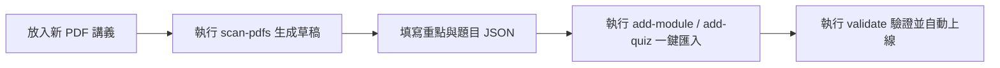

# 密碼學學習平台：後續擴充與維護指南（Extension Guide）

為了確保後續新的教學進度（如公鑰密碼學、RSA、Diffie-Hellman、數位簽章，或後量子密碼學 Lattice、LWE、Kyber、Dilithium）能夠零障礙快速納入，本平台採用**「完全資料驅動（Data-Driven）」**與**「外掛式註冊表（Pluggable Registry）」**雙層解耦架構。

無需修改任何 HTML 或底層 UI 邏輯，即可在數分鐘內擴充章節、題目與實驗室。

---

## 一、 快速擴充三部曲



---

## 二、 命令列管理工具指令一覽（`manage_content.py`）

本目錄提供專屬的命令列維護工具：

| 指令 | 說明 |
| :--- | :--- |
| `python manage_content.py scan-pdfs` | 自動掃描目錄內的 PDF，若發現新講義，自動解析其大綱並產出 `new_module_draft.json` 骨架草稿。 |
| `python manage_content.py add-module <file.json>` | 將 JSON 格式的章節資料合併至 `js/data.js`（若 ID 重複則自動覆蓋更新）。 |
| `python manage_content.py add-quiz <file.json>` | 將新編寫的測驗題目自動追加至題庫中。 |
| `python manage_content.py validate` | 全自動校對檢查：檢驗欄位缺漏、ID 衝突、題目答案索引邊界與公式語法。 |
| `python manage_content.py export-json` | 將全站資料完整備份匯出至 `data/modules.json`、`quizzes.json`、`glossary.json`。 |

---

## 三、 章節模組擴充規範（Module Schema）

新增模組時，只需準備如下格式的 JSON 檔案（例如 `my_new_module.json`）：

```json
{
  "id": "mod-6",
  "number": "06",
  "title": "公鑰密碼學與陷門單向函數",
  "subtitle": "Public-Key Cryptography & Trapdoor Permutations",
  "source": "Lecture 2.1 Public Key.pdf",
  "summary": "本章探討非對稱密碼學革命、Diffie-Hellman 金鑰交換、RSA 加密系統與離散對數問題。",
  "sections": [
    {
      "title": "Diffie-Hellman 金鑰交換協議",
      "content": [
        "**協議流程**：雙方公開質數 $p$ 與生成元 $g$。",
        "- Alice 選取秘密數 $a$，發送 $A = g^a \\pmod p$。",
        "- Bob 選取秘密數 $b$，發送 $B = g^b \\pmod p$。",
        "- 雙方計算共用金鑰 $K = B^a = A^b = g^{ab} \\pmod p$。",
        "**計算 Diffie-Hellman 難題（CDH）**：給定 $(g, g^a, g^b)$，在多項式時間內計算出 $g^{ab}$ 為計算困難問題。"
      ]
    }
  ]
}
```

匯入指令：
```powershell
python manage_content.py add-module my_new_module.json
```
系統會自動更新側邊欄、章節選單、研讀狀態標記與測驗關聯。

---

## 四、 測驗題目擴充規範（Quiz Schema）

新增練習題目時，準備格式如下的 JSON 檔案：

```json
[
  {
    "id": "q6-1",
    "moduleId": "mod-6",
    "category": "概念辨析",
    "question": "在 Diffie-Hellman 金鑰交換協議中，竊聽者 Eve 能夠觀察到哪些數值？",
    "options": [
      "只有質數 $p$ 與生成元 $g$，無法看到 $g^a$ 與 $g^b$",
      "公開參數 $p, g$ 以及交換的公鑰 $g^a \\pmod p$ 與 $g^b \\pmod p$",
      "Alice 的私鑰 $a$ 與 Bob 的私鑰 $b$",
      "計算出的共用金鑰 $g^{ab} \\pmod p$"
    ],
    "answer": 1,
    "explanation": "Diffie-Hellman 透過公開通道傳輸 $g^a$ 與 $g^b$。Eve 雖掌握 $p, g, g^a, g^b$，但受限於離散對數難題（DLP）與 CDH 難題，在計算上無法還原私鑰 $a, b$ 或共用金鑰 $g^{ab}$。",
    "pitfalls": "誤以為公鑰 $g^a$ 必須保密，或誤以為 Eve 只能看到參數。",
    "reference": "Lecture 2.1 Public Key.pdf, p. 12"
  }
]
```

匯入指令：
```powershell
python manage_content.py add-quiz my_new_quizzes.json
```
系統會自動將新題目掛入總題庫、計算正確率並納入章節篩選清單。

---

## 五、 互動實驗室外掛擴充規範（Playground Registry）

若需新增全新的互動演算實驗室（例如：`RSA 加解密運算模擬器`）：

1. 開啟 [js/playgrounds.js](file:///c:/Users/jacks/Downloads/後密碼/js/playgrounds.js)。
2. 編寫該實驗室的邏輯物件（包含 `init()` 與 `render()`）。
3. 在檔案底部的 `PLAYGROUNDS_REGISTRY` 陣列中新增一個項目：

```javascript
PLAYGROUNDS_REGISTRY.push({
    id: 'rsa',
    title: '5. RSA 質數生成與陷門置換演算台',
    description: '視覺化展示質數 p, q 挑選、模數 N=pq 與私鑰 d 計算之數學過程。',
    init: () => RSALab.init(),
    containerId: 'playground-rsa'
});
```

網頁會自動在「互動實驗室」導覽列中新增該標籤，並動態生成對應容器，**完全不需要修改 `index.html`**。
